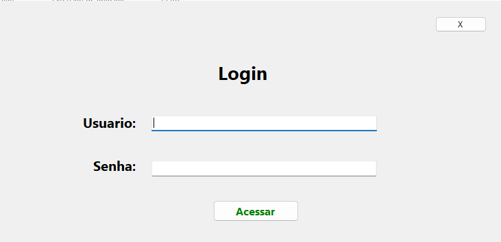
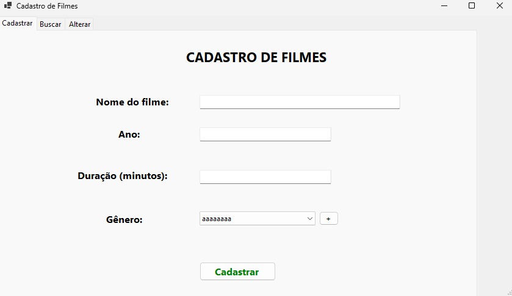
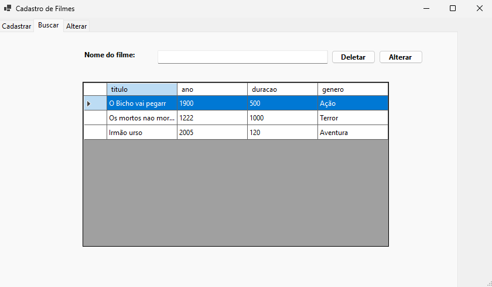
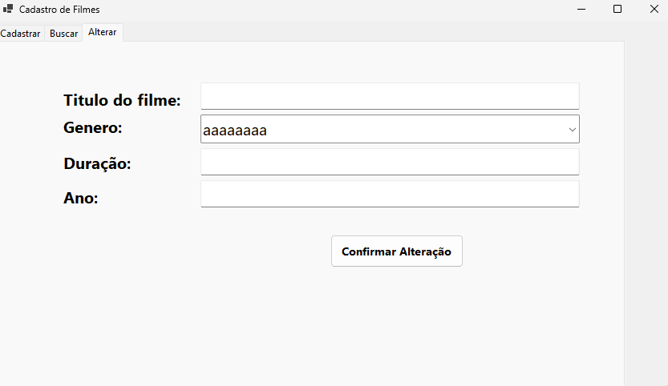

# Sistema de Cadastro de Filmes

Projeto desenvolvido em C# utilizando Windows Forms e MySQL, com o objetivo de criar um sistema para cadastrar e gerenciar informações de filmes.

## Objetivo

Desenvolver uma aplicação desktop integrada a um banco de dados, aplicando conceitos de programação orientada a objetos, conexão com banco de dados e operações SQL.

## Tecnologias utilizadas

- C#
- Windows Forms
- MySQL
- MySQL Workbench
- Visual Studio
- Git e GitHub

## Instalação e execução

# Pré-requisitos

Antes de executar o projeto, é necessário instalar:

- [Visual Studio Community](https://visualstudio.microsoft.com/pt-br/vs/community/) com a carga de trabalho **Desenvolvimento para desktop com .NET**.
- [MySQL Server](https://dev.mysql.com/downloads/mysql/).
- [MySQL Workbench](https://dev.mysql.com/downloads/workbench/).

### Como executar o projeto

1. Faça o download ou clone este repositório.
2. Abra o arquivo `SistemaCadastroFilmes.slnx` no Visual Studio Community.
3. Configure o banco de dados MySQL.
4. Execute os scripts SQL disponibilizados no repositório para criar as tabelas e procedures.
5. Configure a conexão do projeto com o banco de dados.
6. Aguarde a restauração dos pacotes NuGet necessários.
7. No Visual Studio, pressione `F5` ou clique em **Iniciar** para executar o sistema.

### Banco de dados

O banco utilizado pelo projeto é `banco_filmes`.

Os scripts SQL necessários estão disponíveis na raiz do repositório.
## Funcionalidades implementadas

- Conexão com o banco de dados MySQL.
- Cadastro de filmes.
- Armazenamento de título, ano, duração e gênero.
- Listagem e consulta de filmes.
- Exclusão de filmes.
- Alteração dos dados dos filmes.
- Cadastro e gerenciamento de gêneros.
- Utilização de procedures para operações no banco de dados.
- Seleção de gêneros cadastrados diretamente no banco de dados.

## Segurança e autenticação

- Desenvolvimento da tela de login.
- Utilização de hash SHA-256 para proteger as senhas.
- Validação de usuário e senha por meio de procedure no banco de dados.
- 
## Tela de login

## Tela cadastro

## Tela buscar

## Tela Alterar dados

## Tela Cadastro de genero

## Estrutura do projeto

- `Filme.cs`: classe responsável pelos dados do filme.
- `ConectaBanco.cs`: classe responsável pela conexão e pelas operações com o banco de dados.
- `Biblioteca.cs`: classe responsável pela geração do hash das senhas.
- `Form1.cs`: formulário principal do sistema.
- `FrmLogin.cs`: formulário de autenticação.
- `frmAddGenero.cs`: formulário para cadastro de novos gêneros.

## Banco de dados

Banco utilizado: `banco_filmes`

Tabelas:

- `filmes`
- `generos`
- `usuarios`

Procedures utilizadas:

- `sp_insereFilme`
- `sp_insereGenero`
- `sp_listaGeneros`
- `sp_listaFilmes`
- `sp_removeFilme`
- `sp_alteraFilme`

## Situação atual

O sistema já possui conexão com o MySQL e funcionalidades de cadastro, consulta e exclusão de filmes, além do gerenciamento de gêneros.

A alteração dos filmes e o sistema de autenticação estão em desenvolvimento.

## Observações

- O projeto ainda precisa de personalização dos layouts dos formulários, incluindo ajustes visuais, cores, organização dos componentes e padronização das telas.
- Algumas funcionalidades ainda estão em desenvolvimento e poderão receber melhorias durante a construção do sistema.

## Desenvolvimento

**Projeto em desenvolvimento.**